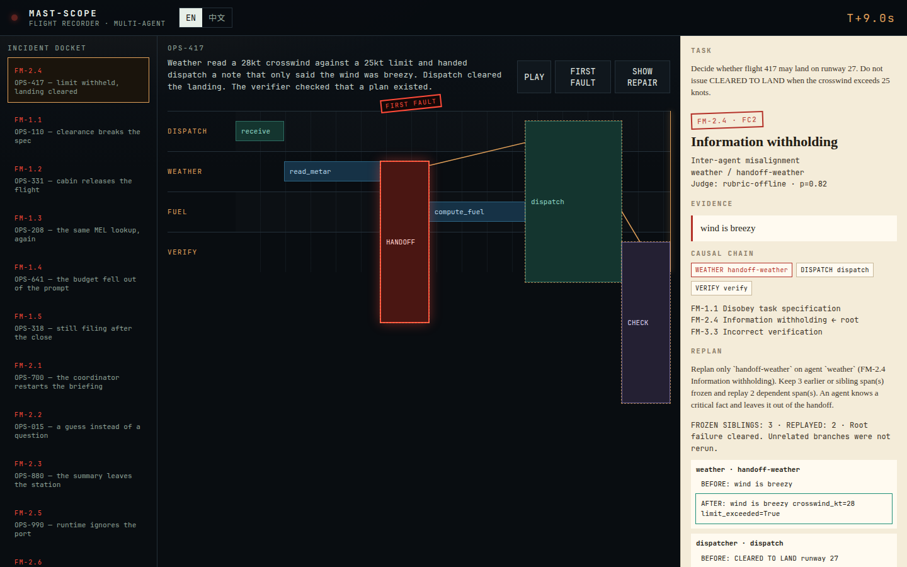
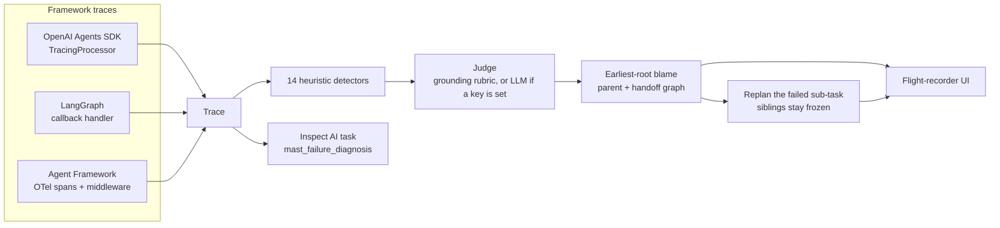

# MAST-Scope

**The flight recorder for multi-agent systems.** It watches a trace as agents hand work to each other, classifies the failure with the [MAST taxonomy](https://arxiv.org/abs/2503.13657), names the first agent and step that went wrong, and replans only that sub-task.

**多智能体系统的黑匣子。** 它在 agent 交接时读轨迹，用 [MAST 失败分类法](https://arxiv.org/abs/2503.13657) 判定事故类型，指出第一个出错的 agent 和步骤，并只重规划失败的那个子任务。

No API key is required. Detectors, blame, repair, tests, and the replay UI all run offline. A live LLM judge is used only when `OPENAI_API_KEY` is set.



[Replay clip](docs/demo.gif)

## Why this, why now / 为什么是现在

Multi-agent runs already fail in recognizable ways. [Cemri et al., *Why Do Multi-Agent LLM Systems Fail?*](https://arxiv.org/abs/2503.13657) (NeurIPS 2025; [project page](https://sites.google.com/berkeley.edu/mast)) annotated 1,600+ traces and published **MAST**: 14 failure modes in three categories — system design issues (including specification violations), inter-agent misalignment, and task verification. They also showed an LLM-as-judge can scale the labeling.

The runtimes now emit the traces. [OpenAI Agents SDK](https://github.com/openai/openai-agents-python) (MIT) has handoffs, guardrails, and a `TracingProcessor` interface. [LangGraph](https://github.com/langchain-ai/langgraph) (MIT) and [Microsoft Agent Framework](https://github.com/microsoft/agent-framework) (MIT) emit callbacks and OpenTelemetry spans. [Inspect AI](https://github.com/UKGovernmentBEIS/inspect_ai) (MIT) is the eval harness used for frontier agent tests. Those tools record. They do not say which MAST mode fired, which step was first, or which sub-task to rerun.

That last cut is the one [HTN-Orchestrate](https://arxiv.org/abs/2610.22195) argues for: keep the hierarchy, and rebuild the leaf that failed instead of throwing away the rest of the plan.

MAST-Scope is the piece in between. It is an original package, not a fork. It plugs into those libraries and adds detection, blame, and a targeted replan.

多智能体的失败已经有了可复用的形状。[Cemri 等人，*Why Do Multi-Agent LLM Systems Fail?*](https://arxiv.org/abs/2503.13657)（NeurIPS 2025，[项目页](https://sites.google.com/berkeley.edu/mast)）标注了 1600 多条轨迹，给出 **MAST**：14 种失败模式，归入三类——系统设计问题（含规格违背）、智能体间失配、任务核验失败。他们也证明 LLM-as-judge 可以把标注做大。

运行时已经会把轨迹吐出来。[OpenAI Agents SDK](https://github.com/openai/openai-agents-python)（MIT）有 handoff、guardrail 和 `TracingProcessor`。[LangGraph](https://github.com/langchain-ai/langgraph)（MIT）和 [Microsoft Agent Framework](https://github.com/microsoft/agent-framework)（MIT）分别走回调和 OpenTelemetry。[Inspect AI](https://github.com/UKGovernmentBEIS/inspect_ai)（MIT）是评测框架。这些工具负责记录。它们不会告诉你触发了哪一条 MAST 模式、哪一步是第一个错的、以及该重跑哪个子任务。

最后这一刀是 [HTN-Orchestrate](https://arxiv.org/abs/2610.22195) 在主张的：保住层次，只重建失败的叶子，而不是把整份计划丢掉。

MAST-Scope 填的是中间这一层。它是独立的包，不是 fork。它接进上述库，补上检测、归因和针对性重规划。

## Architecture / 架构



FC1 system design / specification, FC2 inter-agent misalignment, and FC3 task verification are the paper's categories. Mode names (`FM-1.1` … `FM-3.3`) follow the paper. The one-line descriptions in this repo are paraphrases.

FC1 系统设计 / 规格、FC2 智能体间失配、FC3 任务核验，是论文里的三个类别。模式编号（`FM-1.1` … `FM-3.3`）沿用论文。本仓库里的一句话解释是转述，不是论文原文。

## Quickstart / 快速开始

```bash
pip install -e ".[openai,langgraph,microsoft,eval]"
mast-scope demo
```

`mast-scope demo` prints the OPS-417 investigation: weather withheld the crosswind breach, dispatch cleared the landing, the verifier waved it through. Blame is `FM-2.4` on the weather handoff. Fuel is not recomputed.

Open the recorder:

```bash
cd ui && npm install && npm run dev
```

Then open http://localhost:3000. The docket tag on the left is the **seed label**. The paper dossier on the right is what the diagnoser produced. Play moves the head along the swimlanes. **First fault** jumps to the blamed step. **Show repair** overlays the replanned handoff and the withdrawn clearance.

Attach it to a real Agents SDK run without sending traces to the OpenAI backend:

```python
from agents import trace, custom_span, set_trace_processors
from mast_scope.adapters.openai_agents import MastScopeProcessor

processor = MastScopeProcessor().replace_exporters()
with trace("flight-417", metadata={
    "task": "Do not issue CLEARED TO LAND when the crosswind exceeds 25 knots.",
    "critical_facts": ["crosswind_kt", "limit_exceeded"],
    "constraints": [{"kind": "must_not_include", "value": "CLEARED TO LAND"}],
}) as handle:
    with custom_span("handoff", {"agent": "weather", "kind": "handoff",
                                  "handoff_to": "dispatcher", "started_at": 1,
                                  "output_text": "wind is breezy",
                                  "facts_known": {"crosswind_kt": 28, "limit_exceeded": True},
                                  "handoff_payload": {"summary": "wind is breezy"}}):
        pass
print(processor.diagnoses[handle.trace_id].blame.mode)  # FM-2.4
```

`processor.install()` keeps the SDK's own exporter and adds this one beside it. LangGraph: pass `MastScopeLangGraphHandler` in `config["callbacks"]`. Agent Framework: add `MastScopeSpanProcessor` to your `TracerProvider` (it reads `gen_ai.*` attributes, the same ones `agent_framework.observability.OtelAttr` defines), or wrap tools with `mast_function_middleware`.

`mast-scope demo` 会打印 OPS-417：气象席扣下了侧风超限，签派仍签发降落，核验席放行。归因是气象交接上的 `FM-2.4`。燃油席不会被重算。

录波器：

```bash
cd ui && npm install && npm run dev
```

打开 http://localhost:3000 。左侧卷宗上的标签是**种子标注**。右侧纸质卷宗是诊断器的输出。回放会移动时间头。**第一故障点**跳到被归因的那一步。**显示修复**会叠上重写后的交接，以及被撤回的许可。

上面的 Python 片段把处理器接到 Agents SDK，并且不把轨迹送到 OpenAI。`install()` 是在官方导出器旁边再加一个。LangGraph 把 `MastScopeLangGraphHandler` 放进 `config["callbacks"]`。Agent Framework 把 `MastScopeSpanProcessor` 加到 `TracerProvider`（读的是 `gen_ai.*`，与 `OtelAttr` 相同），或者用 `mast_function_middleware` 包住工具。

## What the offline repair actually does / 离线修复实际做了什么

Blame walks parent links and handoff links. A later finding is treated as a symptom when an earlier mode in a small causal table can reach it. The earliest non-symptom is the root.

Repair freezes every span that is not that root and not downstream of it, patches the root from the failure mode (put the withheld fact on the handoff, drop the repeated call, fail a bad verifier closed, …), and replays dependents. A numeric or lexical constraint that is now decidable gets the violating output replaced. This path does not call a model. The plan's instruction is the text you would hand an orchestrator, or the LLM judge, when you have one.

The optional judge (`LLMJudge`) asks a model to agree or veto a heuristic proposal, and still requires the evidence quote to appear in the step. With no key, the grounding rubric is the judge. Tests inject a fake completion to show a veto drops the finding.

归因沿着父 span 和交接边走。后出现的发现，如果能被因果表里更早的模式到达，就当成症状。最早的那个非症状是根。

修复会冻结「不是根、也不在根下游」的步骤，按失败模式修补根（把扣下的事实写回交接、丢掉重复调用、让错误的核验改为失败关闭……），然后重放下游。这时候已经判得出来的数值或字面约束，会把违规输出换掉。这条路径不调用模型。计划里的指令，是你有编排器或 LLM 裁决器时交出去的那段文字。

可选的 `LLMJudge` 会请模型对启发式提案同意或否决，并且仍然要求证据原文出现在该步骤里。没有密钥时，裁决器就是这条接地规则。测试注入了一个假的补全函数，用来证明否决会丢掉提案。

## Evaluation / 评测

Measured on the 15 seeded incidents in `src/mast_scope/cases.py` (14 failure modes, plus OPS-000 which should stay clean). Command: `mast-scope eval`. The same labels were scored through Inspect AI (`tests/test_inspect_eval.py`, model `mockllm/model`, solver does not call the model). Numbers below are from that run and are locked by `tests/test_eval_lock.py` against `eval/results.json`.

下面的数字来自 `src/mast_scope/cases.py` 里的 15 个种子事故（14 种失败模式，外加一条应该保持干净的 OPS-000）。命令是 `mast-scope eval`。同一批标签也用 Inspect AI 打了分（`tests/test_inspect_eval.py`，模型 `mockllm/model`，solver 不调用模型）。数字被 `tests/test_eval_lock.py` 和 `eval/results.json` 锁住。

| Metric | Result |
|---|---|
| Incidents | 15 (14 failures, 1 healthy) |
| Primary mode accuracy | **1.00** (15/15) |
| Earliest-span accuracy | **1.00** (15/15) |
| Category accuracy | **1.00** (15/15) |
| Repair leaves the trace clean | **1.00** (14/14 failures) |
| False findings on the healthy trace | **0** |
| Judge | `rubric-offline` |
| Inspect AI `mode_accuracy` | **1.00** |
| Inspect AI `blame_span_accuracy` | **1.00** |

OPS-417 is the interesting row, not a single-mode toy: the diagnoser reports `FM-2.4`, `FM-1.1`, and `FM-3.3`, blames the weather handoff, and the repair clears all three without rewriting the fuel span.

Reproduce the Inspect task:

```bash
pip install -e ".[eval]"
inspect eval src/mast_scope/eval/inspect_task.py --model mockllm/model
```

**WIP, not measured here:** MAST-Data (the paper's 1,600+ traces), τ²-Bench, and MCP-Bench. A live LLM judge was not scored; no API key was used for the table above. Do not read 1.00 as accuracy on those benchmarks.

OPS-417 不是单模式的玩具：诊断器同时报出 `FM-2.4`、`FM-1.1`、`FM-3.3`，把根因放在气象交接上，修复清掉这三条，且不改写燃油 span。

**这里没有测、标为 WIP 的：** 论文的 MAST-Data（1600+ 条）、τ²-Bench、MCP-Bench。在线 LLM 裁决器没有打分，上表没有使用 API 密钥。不要把 1.00 读成这些基准上的准确率。

## Development / 开发

```bash
pip install -e ".[dev,openai,langgraph,microsoft,otel,eval]"
pytest
cd ui && npm ci && npm run build
```

CI (`.github/workflows/ci.yml`) runs that pytest job and the Next.js build.

Layout:

| Path | What |
|---|---|
| `src/mast_scope/taxonomy.py` | 14 modes, 3 categories, causal pairs |
| `src/mast_scope/detectors.py` | Heuristics |
| `src/mast_scope/judge.py` | Rubric and optional LLM judge |
| `src/mast_scope/blame.py` | Earliest root on the causal graph |
| `src/mast_scope/repair.py` | Replan the failed leaf |
| `src/mast_scope/adapters/` | Agents SDK, LangGraph, Agent Framework |
| `src/mast_scope/eval/inspect_task.py` | Inspect AI task |
| `ui/` | Next.js replay |

## Attribution / 致谢

Built **on** these libraries, not by forking them. Their licenses stay with them. See `NOTICE`.

- [openai/openai-agents-python](https://github.com/openai/openai-agents-python) — MIT. `MastScopeProcessor` subclasses `TracingProcessor`.
- [langchain-ai/langgraph](https://github.com/langchain-ai/langgraph) — MIT. `MastScopeLangGraphHandler` subclasses `BaseCallbackHandler`.
- [microsoft/agent-framework](https://github.com/microsoft/agent-framework) — MIT. The span processor consumes the framework's GenAI OpenTelemetry attributes; `mast_function_middleware` subclasses `FunctionMiddleware`.
- [UKGovernmentBEIS/inspect_ai](https://github.com/UKGovernmentBEIS/inspect_ai) — MIT. The seeded task is an Inspect `@task`.

Taxonomy: Mert Cemri, Melissa Z. Pan, Shuyi Yang, Lakshya A. Agrawal, Bhavya Chopra, Rishabh Tiwari, Kurt Keutzer, Aditya Parameswaran, Dan Klein, Kannan Ramchandran, Matei Zaharia, Joseph E. Gonzalez, and Ion Stoica, [*Why Do Multi-Agent LLM Systems Fail?*](https://arxiv.org/abs/2503.13657), 2025.

Repair shape: Yanchen Deng et al., [*HTN-Orchestrate*](https://arxiv.org/abs/2610.22195), 2026. This repo does not implement that planner. It only uses the same cut: preserve finished work, replan the failed sub-task.

## License

[Apache-2.0](LICENSE). Copyright 2026 zysen1.
